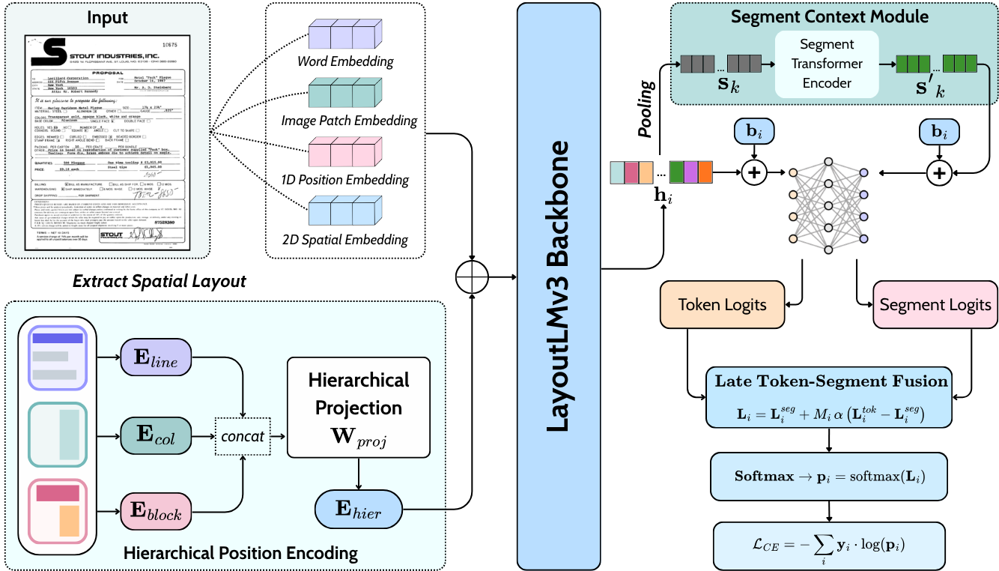
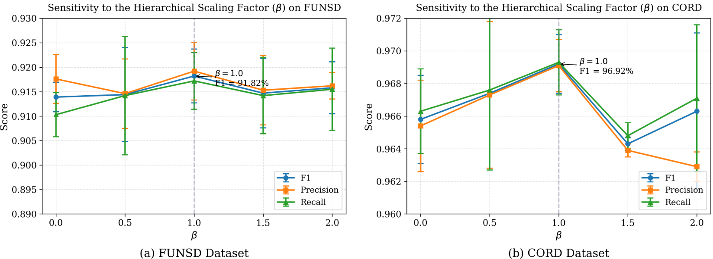
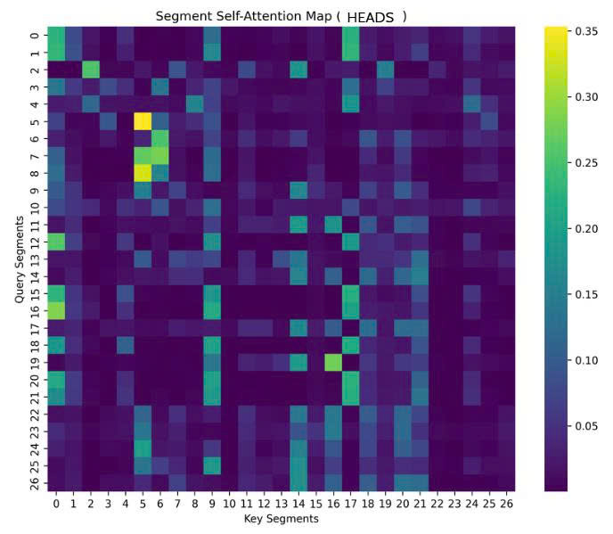

# HEADS: Hierarchical Encoding and Dual-Level Token-Segment Fusion for Document Key Information Extraction

Official implementation of **HEADS**, a lightweight fine-tuning-time extension of LayoutLMv3 for Key Information Extraction (KIE) from visually rich documents.

**Thanh-Nga Hoang Thi\*, Thu-Phuong Bui\*, Thanh-Thu Nguyen Mai, Quynh-Trang Pham Thi†, Thanh-Dat Vu, Duc-Trong Le†**

VNU University of Engineering and Technology (VNU-UET), Viettel Solutions

\* Equal contribution. † Corresponding authors.

## Overview

Token-level KIE models can locate an entity but cut it short when later tokens drift to another label. Pooling tokens into segments makes labels more consistent, but it also removes the token-level distinctions that BIO tagging needs.

HEADS follows one principle: **decide at the segment level, refine at the token level.** It adds three components to a pretrained backbone, with no additional pre-training:

| Component | Level | What it does |
| --- | --- | --- |
| **Hierarchical Position Encoding (HPE)** | Input | Adds line, block, and column-region embeddings to the input embeddings. |
| **Segment Context Module (SCM)** | Representation | Mean-pools tokens into segments and exchanges reading-order context through one gated Transformer layer. |
| **Late Token-Segment Fusion (LTSF)** | Decision | Gives continuation tokens a bounded, single-scalar correction from token-level logits. |

<p align="center">
  
</p>
<p align="center"><em>Overview of the HEADS architecture.</em></p>

The final logits for token $i$ are:

$$L_i = L_i^{seg} + M_i\,\alpha\,(L_i^{tok} - L_i^{seg}), \qquad \alpha = \alpha_{max}\,\sigma(w)$$

where $M_i = 1$ only for non-first tokens of multi-token segments, and $\alpha_{max} = 0.15$.

## Results

Entity-level scores (%), reported as mean ± std over 3 seeds (42, 123, 1993). The LayoutLMv3 baselines were reproduced under the same pipeline, schedule, and seeds as HEADS.

| Model | Params | FUNSD P | FUNSD R | FUNSD F1 | CORD P | CORD R | CORD F1 |
| --- | ---: | ---: | ---: | ---: | ---: | ---: | ---: |
| LayoutLMv3 base | 133M | 89.26 ± 1.52 | 90.23 ± 0.80 | 89.74 ± 1.15 | 95.97 ± 0.07 | 96.31 ± 0.16 | 96.14 ± 0.06 |
| **HEADS base** | 138M | **91.92 ± 0.59** | **91.72 ± 0.58** | **91.82 ± 0.55** | **96.91 ± 0.16** | **96.93 ± 0.20** | **96.92 ± 0.18** |
| LayoutLMv3 large | 368M | 91.20 ± 0.33 | 91.92 ± 0.38 | 91.56 ± 0.35 | 96.59 ± 0.59 | 96.73 ± 0.41 | 96.66 ± 0.50 |
| **HEADS large** | 377M | **92.28 ± 0.12** | **92.53 ± 0.60** | **92.41 ± 0.30** | **97.40 ± 0.23** | **97.40 ± 0.23** | **97.40 ± 0.23** |

<details>
<summary>Ablation on LayoutLMv3 base (F1, %)</summary>

| HPE | SCM | LTSF | FUNSD | CORD |
| :-: | :-: | :-: | ---: | ---: |
| | | | 89.74 ± 1.15 | 96.14 ± 0.06 |
| ✓ | | | 89.80 ± 0.25 | 96.54 ± 0.32 |
| | ✓ | | 91.28 ± 0.24 | 96.76 ± 0.69 |
| ✓ | ✓ | | 91.47 ± 0.79 | 96.81 ± 0.15 |
| | ✓ | ✓ | 91.33 ± 0.30 | 96.58 ± 0.27 |
| ✓ | ✓ | ✓ | **91.82 ± 0.55** | **96.92 ± 0.18** |

</details>

<p align="center">
  
</p>
<p align="center"><em>Sensitivity to the hierarchical scaling factor β. On FUNSD, the differences are within one standard deviation.</em></p>

<p align="center">
  
</p>
<p align="center"><em>Segment Transformer self-attention on a FUNSD test document, averaged over heads.</em></p>

## Repository Structure

```text
HEADS/
├── docs/images/                 # README figures
├── examples/
│   └── run_funsd_cord.py        # Training, evaluation, and HPE preprocessing
├── layoutlmft/
│   ├── data/                    # FUNSD/CORD loaders and data collator
│   └── models/layoutlmv3/
│       ├── modeling_layoutlmv3.py          # Backbone with HPE
│       └── modeling_layoutlmv3_segment.py  # SCM, boundary embedding, LTSF
├── scripts/                     # Original 3-seed experiment scripts
├── requirements.txt
└── setup.py
```

## Installation

The code targets the original LayoutLMv3 stack: Python 3.7, `transformers==4.12.5`, and `datasets==1.15.1`. Use Linux with a CUDA GPU.

```bash
git clone https://github.com/Ngahoang2005/HEADS.git
cd HEADS

conda create -n heads python=3.7 -y
conda activate heads

# Choose the build matching your CUDA driver: https://pytorch.org/get-started/previous-versions/
pip install torch==1.10.0+cu113 torchvision==0.11.0+cu113 \
  -f https://download.pytorch.org/whl/torch_stable.html

# Required by layoutlmft/data/image_utils.py
pip install "git+https://github.com/facebookresearch/detectron2.git"

pip install -r requirements.txt
pip install -e .
```

## Data and Pretrained Models

**Datasets.** FUNSD and CORD are downloaded automatically on the first run through the loaders in `layoutlmft/data/`.

**Backbones.** Training expects the checkpoints under `models/`:

```bash
for NAME in layoutlmv3-base layoutlmv3-large; do
  mkdir -p "models/$NAME"
  for FILE in config.json merges.txt vocab.json tokenizer_config.json preprocessor_config.json pytorch_model.bin; do
    curl -fL "https://huggingface.co/microsoft/$NAME/resolve/main/$FILE" -o "models/$NAME/$FILE"
  done
done
```

## Training and Evaluation

Run all commands from the repository root.

```bash
export PYTHONPATH="$PWD:$PYTHONPATH"
export TOKENIZERS_PARALLELISM=false
export WANDB_DISABLED=true
```

### Train HEADS

This example trains HEADS base on FUNSD with one seed and evaluates on the test split:

```bash
python -m torch.distributed.run --nproc_per_node=1 --master_port=4398 \
  examples/run_funsd_cord.py \
  --dataset_name funsd \
  --model_name_or_path models/layoutlmv3-base \
  --output_dir logs/heads-funsd-base-seed42 \
  --do_train --do_eval \
  --use_segment_head \
  --use_hierarchical_position_encoding \
  --use_column_encoding True \
  --max_line_position 100 --max_block_position 30 --max_column_position 8 \
  --segment_level_layout 1 --visual_embed 1 --input_size 224 \
  --max_steps 1000 --warmup_ratio 0.1 \
  --learning_rate 1e-5 \
  --per_device_train_batch_size 2 --gradient_accumulation_steps 8 \
  --evaluation_strategy steps --eval_steps 100 --save_steps 1000 \
  --dataloader_num_workers 4 --report_to none \
  --seed 42 --overwrite_output_dir --overwrite_cache
```

Metrics are written to `<output_dir>/eval_results.json`.

### Settings per Dataset

| Argument | FUNSD | CORD |
| --- | --- | --- |
| `--dataset_name` | `funsd` | `cord` |
| `--learning_rate` (backbone) | `1e-5` | `5e-5` |
| `--per_device_train_batch_size` | `2` | `2` |
| `--gradient_accumulation_steps` | `8` (effective batch 16) | `32` (effective batch 64) |
| `--max_line_position` | `100` | `80` |
| `--max_block_position` | `30` | `15` |
| `--max_column_position` | `8` | `8` |

For the large model, set `--model_name_or_path models/layoutlmv3-large`. The classifier and new modules use a fixed learning rate of `5e-4`, set in `examples/run_funsd_cord.py`.

### Ablations

| Configuration | Change to the command above |
| --- | --- |
| Baseline LayoutLMv3 | Remove `--use_segment_head` and all HPE arguments. |
| SCM + LTSF | Remove the HPE arguments. |

### Multi-Seed Runs

```bash
for SEED in 42 123 1993; do
  # Run the training command with:
  #   --seed "$SEED" --output_dir "logs/heads-funsd-base-seed$SEED"
  :
done
```

The scripts in `scripts/` contain the original experiment runs and compute mean ± std. They include absolute paths from the authors' machine, so update the `cd` and `PYTHONPATH` lines before using them.

## Known Limitations

- HEADS relies on text segments at inference. The experiments use the segment-level boxes provided by each dataset.
- HPE uses fixed-threshold grouping, which may be brittle on skewed or very dense layouts.
- The fusion coefficient $\alpha$ is one global scalar.
- HEADS mainly reduces boundary errors and does not reduce entity-type confusions.
- `--do_eval` currently requires `--do_train`, because the batch check in `run_funsd_cord.py` reads the training dataset.

## Citation

```bibtex
@unpublished{hoang2026heads,
  title  = {HEADS: Hierarchical Encoding and Dual-Level Token-Segment Fusion for Document Key Information Extraction},
  author = {Hoang Thi, Thanh-Nga and Bui, Thu-Phuong and Nguyen Mai, Thanh-Thu and Pham Thi, Quynh-Trang and Vu, Thanh-Dat and Le, Duc-Trong},
  note   = {Manuscript},
  year   = {2026}
}
```

## Acknowledgements

This repository builds on [LayoutLMv3 from Microsoft UniLM](https://github.com/microsoft/unilm/tree/master/layoutlmv3) and [Hugging Face Transformers](https://github.com/huggingface/transformers).
